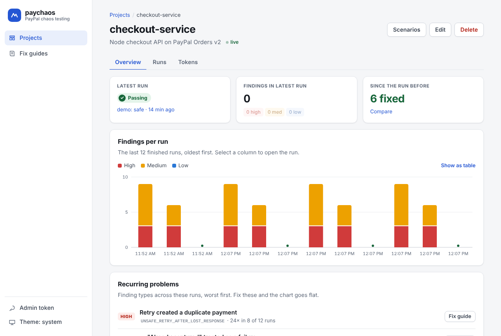

# paychaos: chaos testing for PayPal integrations

[](https://github.com/shangai2405/paychaos/actions/workflows/ci.yml)
[](LICENSE)

`paychaos` is a fault-injecting proxy, written in Go, that sits between your application and the PayPal REST API (sandbox only) and breaks things the way real networks do. It lets PayPal **commit a request and then loses the response on purpose**, returns 500s for requests that went through, holds responses until clients time out, expires access tokens, and duplicates, delays and reorders webhooks. While it does that it audits how your integration reacts and reports retry patterns that would **double-capture, double-refund or double-pay out** in production, naming the duplicate resources the retry created.

Around the engine sit a Node/TypeScript API, a PostgreSQL store and a React dashboard that keep run history, show findings live, track each project's health across runs, explain every finding with a fix guide, draw a retry timeline per operation, compare runs and export them for CI. The engine works on its own from the command line; the dashboard is an addition, not a dependency.




## Why

The most expensive payment bug is the one that looks like a network blip:

1. Your server sends `POST /v2/payments/captures/{id}/refund`.
2. PayPal refunds the buyer and responds.
3. The response is lost (load balancer reset, timeout, pod restart), or comes back as a 500 although the refund went through.
4. Your code sees an error and retries.

If the retry carries the same `PayPal-Request-Id`, PayPal returns the refund it already made. If it carries none, or a new one, PayPal refunds again. If it doesn't retry, your app records a failed refund that succeeded. Local networks don't lose responses, so none of this shows up in testing. `paychaos` makes it happen on purpose.

PayPal's sandbox can already return a chosen error when you send a `PayPal-Mock-Response` header (a feature PayPal labels beta). That returns error responses; it does not process a request and then lose the reply. That second case, committed upstream but never seen by the client, is what `paychaos` adds, together with an auditor that ties the retry back to the lost original and names both resources.

## Results from the bundled demo

`make demo` runs three hand-written clients against the built-in mock with `examples/scenarios/lost-responses.json` (seed 7, 20 checkouts each: create order, capture, and a partial refund on every third order). Numbers below are from a run on this commit; same seed and request order give the same faults.

| Client | Reported to the app | Created upstream | Findings |
|---|---|---|---|
| `naive-client`: no `PayPal-Request-Id`, instant retries, never refreshes its token | 13 paid, 4 refunds | **24** orders, 19 captures, **5** refunds | 5 high, 12 medium, 5 low |
| `rotating-id-client`: a new clock-based id on every attempt | 13 paid, 4 refunds | **24** orders, 19 captures, **5** refunds | 5 high, 8 medium |
| `safe-client`: one UUID per step reused on retries, backoff, GET after 422 | 20 paid, 7 refunds | 20 orders, 20 captures, 7 refunds | none |

Two things the naive clients' own logs can't show: an extra refund went out for one order, and six checkouts the client reported as failed were in fact captured (PayPal answered the retried capture with `422 ORDER_ALREADY_CAPTURED`, and the client treated that as an error instead of reading the order).

## Quick start

Requires Go 1.24+. The engine has no third-party dependencies.

```bash
go install github.com/shangai2405/paychaos/cmd/paychaos@latest
```

Or from a clone:

```bash
git clone https://github.com/shangai2405/paychaos.git
cd paychaos
make test        # unit and end-to-end tests with the race detector
make demo        # the three example clients, no PayPal account needed
```

### Against the PayPal sandbox

```bash
paychaos -config examples/scenarios/lost-responses.json   # upstream defaults to https://api-m.sandbox.paypal.com
```

Point your app's PayPal API base URL at `http://127.0.0.1:8080` and run your checkout flow or test suite. `/v1/oauth2/token` passes straight through. Press Ctrl-C to stop; the summary prints and the full report is written to `paychaos-report.json`.

### With the dashboard

```bash
docker compose up --build          # API + dashboard on http://127.0.0.1:3000, PostgreSQL 16
```

The port is published on `127.0.0.1` only. To protect the dashboard with a token (required before exposing it anywhere else):

```bash
ADMIN_TOKEN=$(openssl rand -hex 24) ALLOW_OPEN_DASHBOARD=false docker compose up --build
```

Create a project and an ingest token in the dashboard, then:

```bash
PAYCHAOS_TOKEN=pct_... paychaos -upstream mock -report-to http://127.0.0.1:3000 -run-name "checkout v2"
```

Without Docker: start PostgreSQL 16, then `cd api && npm ci && DATABASE_URL=postgres://... npm run dev`, and `cd web && npm ci && npm run dev` (the dev server on :5173 proxies `/api` to :3000). `REPORT_TO=http://127.0.0.1:3000 PAYCHAOS_TOKEN=... make demo` streams the demo runs.

### What the dashboard does

| Page | What it is for |
|---|---|
| **Projects** | Every integration under test with the health of its latest run (passing, needs attention, failing). |
| **Project → Overview** | Latest run's status, what changed since the run before (new and fixed findings), a findings-per-run chart, and the finding types that keep recurring, each linked to its fix guide. |
| **Project → Runs / Tokens** | Run history with keyset paging and two-run comparison; ingest tokens with their last use, revocable with confirmation. |
| **Run** | Findings in plain language with an on-demand fix guide and code example, the per-operation retry timeline, webhook deliveries, the exact scenario used, and downloads as JSON, JUnit or Markdown (the same formats the engine writes). |
| **Scenarios** | A JSON editor validated live with the engine's own rules, with unsaved-change protection. |
| **Fix guides** | Every finding code: business impact, cause, the fix, and example code. |

Destructive actions (delete a run, a project, a scenario; revoke a token) ask first; deleting a project requires typing its name. The layout works from phone to desktop, follows the system light/dark setting (or a manual choice), and is keyboard and screen-reader friendly. Live updates arrive over Server-Sent Events.

### Webhooks

```bash
paychaos -webhook-listen 127.0.0.1:8081 -webhook-target http://127.0.0.1:3000/paypal/webhook
```

Expose the relay through a tunnel and set it as the sandbox app's webhook URL. The relay acknowledges each event at once, then delivers it with injected duplicates, random delays and shuffled order. It forwards the raw body bytes and every `PAYPAL-*` header (`PAYPAL-TRANSMISSION-ID`, `-TIME`, `-SIG`, `PAYPAL-CERT-URL`, `PAYPAL-AUTH-ALGO`) unchanged, so a duplicate verifies exactly like one of PayPal's own redeliveries, whether you verify locally or via `/v1/notifications/verify-webhook-signature`. This matches real behaviour: PayPal redelivers on any non-2xx reply, up to 25 times over 3 days. `examples/scenarios/webhook-storm.json` turns webhook chaos up and injects no API faults.

## Safety

- **Live money is refused by host.** Access tokens carry no sandbox/live marker, so the guard is an allowlist: the engine starts only if the upstream is `https://api-m.sandbox.paypal.com`, `https://api.sandbox.paypal.com`, the built-in mock, or a host you name with `-allow-upstream` (for a mock started separately). Anything else fails at startup, before any traffic.
- **Secrets stay in the engine.** The `/v1/oauth2/token` call carries the client secret; it is never logged, audited, stored or sent to the API. Authorization headers are never sent to the API either. Requests are grouped by account using a short hash; access tokens obtained through the proxy are mapped back to a hash of their client id, so a token refresh between a lost response and its retry doesn't hide the duplicate.
- Ingest tokens are stored as SHA-256 hashes and shown once, at creation. The dashboard shows when each was last used.
- The proxy and the API bind to `127.0.0.1` by default. **The API refuses to start an unauthenticated dashboard on any other address** unless `ADMIN_TOKEN` (16+ characters) is set, or `ALLOW_OPEN_DASHBOARD=true` says the port is only reachable locally (Compose sets this because it publishes on `127.0.0.1`).
- **Failed authentication is rate-limited** per client address (20 failures a minute, then 429 for the rest of the window, even with a correct token). Set `TRUST_PROXY=true` behind a reverse proxy so the real client address is used.
- Every response carries a strict Content-Security-Policy (`script-src 'self'`, `frame-ancestors 'none'`), `nosniff`, `no-referrer` and related headers. Server errors return a request id, never internals.
- Exports are downloaded with the token in a header, never in a URL.

## Faults

| Fault | What happens | Reaches upstream? |
|---|---|---|
| `drop_after_commit` | Forwarded and processed, then the client connection is reset (TCP RST) before the response arrives | Yes |
| `error_500_after_commit` | Forwarded and processed, then the client is told `500 INTERNAL_SERVER_ERROR` | Yes |
| `hold_response` | Forwarded and processed; the response is held for `delay_ms`, so a client with a shorter timeout gives up | Yes |
| `truncate_after_commit` | Forwarded and processed; the client gets the real status and headers but only half the body, then a TCP reset | Yes |
| `timeout_before_forward` | Proxy stalls, then answers 504 | No |
| `token_expired_401` | `401 invalid_token`, as for an expired access token | No |
| `rate_limit_429` | PayPal-shaped `429 RATE_LIMIT_REACHED` | No |
| `error_500` | PayPal-shaped `500 INTERNAL_SERVER_ERROR` | No |
| `latency` | Delay, then forwarded normally | Yes |

Rules are evaluated in file order; the first matching rule that fires wins. Print the default scenario with `paychaos scenario`, and check your own files with `paychaos validate my-scenario.json`. The dashboard's scenario editor validates with the same rules.

## What the auditor flags

POSTs to the money-moving endpoints are audited: create, capture and authorize order (`/v2/checkout/orders…`), capture authorization (`/v2/payments/authorizations/{id}/capture`), refund capture (`/v2/payments/captures/{id}/refund`) and create payout (`/v1/payments/payouts`). Configure with `mutating_paths`. PayPal documents that not every API honours `PayPal-Request-Id`, so which endpoints do is per-endpoint configuration (`request_id_paths`), not a global rule.

| Code | Severity | Meaning |
|---|---|---|
| `UNSAFE_RETRY_AFTER_LOST_RESPONSE` | HIGH | A request committed upstream but its result never reached the client, and a retry with no id or a different id **also committed**. Names both resources. |
| `UNSAFE_RETRY_FAILED_THIS_TIME` | MEDIUM | The same unsafe retry, but it failed this time, so no duplicate was created in this run. |
| `COMMITTED_BUT_REPORTED_AS_FAILED` | MEDIUM | A request committed upstream, the client got an error or nothing, and never retried or looked the resource up. |
| `ALREADY_CAPTURED_NOT_RECONCILED` | MEDIUM | A retried capture got `422 ORDER_ALREADY_CAPTURED` (or `ORDER_ALREADY_AUTHORIZED`, `AUTHORIZATION_ALREADY_CAPTURED`) and the client never fetched the order to read the capture id, which is PayPal's advice. PayPal blocked the duplicate; the client probably recorded a failure for a payment that succeeded. |
| `TOKEN_NOT_REFRESHED` | MEDIUM | After a `401 invalid_token` the client sent the same access token again instead of calling `/v1/oauth2/token`. |
| `NEW_REQUEST_ID_AFTER_INDETERMINATE_ERROR` | MEDIUM | Retried with a new id after a 409, a 5xx or a timeout. Those outcomes are indeterminate; a new id can start a second operation. |
| `REQUEST_ID_REUSED_WITH_DIFFERENT_BODY` | MEDIUM | One id used for two different requests. PayPal answers with the first request's resource, so the second request's changes are silently ignored. |
| `MISSING_REQUEST_ID` | MEDIUM | A money-moving POST without `PayPal-Request-Id` on an endpoint that honours it. Without it PayPal processes a repeated request again. |
| `REQUEST_ID_TOO_LONG` | LOW | The id is longer than PayPal's 38-character limit. PayPal recommends a UUID. |
| `RETRY_WITHOUT_BACKOFF` | LOW | Retried a 429/5xx faster than `min_backoff_ms`. |
| `TRUNCATED_SUCCESS_NOT_RETRIED` | LOW | A request committed and the client got a 2xx, but the body was cut short and it never retried. |

### Grouping retries by operation

By default two requests are "the same operation" when they share account, method, path and body. JSON bodies are canonicalised (key order and whitespace don't matter, numbers are kept exactly as written), so a client that rebuilds its JSON between attempts is still recognised. That still misses clients that change something between attempts, such as an attempt counter. Set `operation_id` to the body fields that identify one business operation, as dotted JSON paths:

```json
"operation_id": ["purchase_units.0.invoice_id", "invoice_id"]
```

Requests carrying one of them are grouped by its value instead. PayPal's `invoice_id` exists for exactly this kind of reconciliation, so most integrations already send one.

The process exits with status `2` when any HIGH finding exists, so it can gate a CI job (`-fail-on-high=false` to disable). A live JSON report is served at `GET /__paychaos/report`.

## CI integration

```bash
paychaos -config paychaos.json -junit paychaos-junit.xml -markdown "$GITHUB_STEP_SUMMARY"
paychaos compare -fail-on medium baseline.json current.json
```

- `-junit FILE` writes one failing test case per finding, so CI test reporters show findings next to ordinary test results.
- `-markdown FILE` appends a summary table, suited to `$GITHUB_STEP_SUMMARY`.
- `paychaos compare` fails only on findings a change introduces. Findings are grouped by code, severity and path and counted, because request numbers and resource ids differ between runs. Both runs should use the same seed, scenario and workload. The dashboard's compare view uses the same rule.

[`examples/ci/github-actions.yml`](examples/ci/github-actions.yml) is a complete workflow that builds a baseline on the base branch and compares the pull request against it.

## PayPal behaviour that is modelled

From PayPal's idempotency, Orders and webhooks documentation:

- **Idempotency uses `PayPal-Request-Id`** on POST calls. The id is stored for a period that varies by API (examples: 6 hours for a create-order call with a payment source, up to 45 days for a refund). The mock can forget ids early (`-mock-request-id-ttl`) to test late retries; `examples/scenarios/late-retries.json` holds refund responses long enough for clients to give up.
- **A same-id retry returns the latest state** of the resource the first request produced, not a replay of the original response. The mock does this, which is why there is no cached-500 logic: after a 500, a same-id retry gets the resource.
- **Without the header, a repeated request is processed again.**
- **Two simultaneous requests with one id:** the first is processed and the second might fail. The mock answers the second with 409; the auditor does not depend on that status.
- **Capturing a captured order is `422 ORDER_ALREADY_CAPTURED`;** PayPal's advice is to GET the order.
- **Success codes:** capture returns 201, authorization 200. "Committed" means any 2xx.

### To verify in the sandbox

These are modelled on a best guess and should be checked against `api-m.sandbox.paypal.com` before relying on them:

- whether create-order without `PayPal-Request-Id` is rejected with 400 when a payment source is included (a community report says so; not modelled);
- that two partial refunds of one capture without a request id both succeed (the mock assumes so; it is the clearest double-money case);
- where the capture id sits in the capture-order response (the proxy reads `purchase_units[].payments.captures[]`, falling back to the top-level id);
- the exact body and status PayPal returns for an expired token and for a rate limit;
- whether a same-id capture retry answers 201 or 200 (the mock answers with the original status).

## Architecture

| Part | Stack | Responsibility |
|---|---|---|
| Engine | Go, standard library only | Fault proxy, retry auditor, webhook relay, PayPal-shaped mock. `-report-to URL -token T` streams events to the API. |
| API | Node 22, TypeScript, Fastify, zod, pg | REST endpoints, input validation, ingest, live stream. Holds no state between requests. |
| Database | PostgreSQL 16 | Projects, tokens, scenarios, runs, requests, findings, webhook deliveries. Hand-written SQL migrations ([`api/migrations`](api/migrations)), no ORM. |
| Dashboard | React, TypeScript, Vite, TanStack Query, React Router | Project health and trends, findings with fix guides, per-operation retry timeline, run comparison and export, scenario editor. No UI framework: a small design system in one stylesheet. |

### Design decisions

These are the parts that are easy to get subtly wrong.

**Engine**

- **Truncation keeps the real status.** `truncate_after_commit` writes the upstream's own status line and a `Content-Length` for the full body, then sends half of it and resets. The client holds a genuine 201; only parsing fails.
- **A real TCP reset, not an error response.** `drop_after_commit` hijacks the client connection and closes it with `SO_LINGER` 0, so the client sees "connection reset by peer". Returning a 502 would tell the client the request failed, which is a different and easier case.
- **The upstream call outlives the client.** For faults that cut the client off, the upstream request uses `context.WithoutCancel`, so cutting the client doesn't cancel the capture mid-flight.
- **Record before reset.** The proxy records the committed attempt before resetting the connection, so the client's retry is guaranteed to see it.
- **Verdicts wait for the outcome.** Whether a retry duplicated something is decided when the retry completes. A retry PayPal refuses with "already captured" is not called a duplicate; whether the client then reconciled is decided at report time by looking for a GET of the order after the 422.
- **Evidence over inference.** The proxy reads the created resource's id from each response, so a finding names both refund ids instead of saying a duplicate "probably" happened.
- **Reproducible faults.** Every fault decision comes from a seeded PRNG, drawn for every matching rule whether or not it fires. Findings and the text report are sorted deterministically, so two runs with the same seed and request order print byte-identical summaries.

**Engine to API**

- **Ingest is retry-safe.** The engine sends events in numbered batches. `(run_id, seq)` is the primary key of `ingest_batches` and the insert uses `ON CONFLICT DO NOTHING`, so a batch sent twice is stored once. The run itself is created with an idempotent `PUT` keyed by a UUID the engine generates. The tool that finds missing idempotency does not lack it.
- **The proxy path never waits on the API.** Events go into a bounded in-memory queue (10,000). A background sender batches them (200 events or 500 ms), retries with capped exponential backoff, and once the queue is full, events are appended to a local NDJSON spill file instead. A slow or absent dashboard cannot change fault timing. The final JSON report on disk is always complete.
- **Findings stream, then the finish message replaces them.** Some findings (a lost response never retried, a 422 never followed by a GET) can only be decided once traffic stops, so streamed findings are marked provisional and the finish message swaps in the final list in one transaction.

**API and database**

- **Any API instance can serve any live stream.** Ingest issues `pg_notify` inside its transaction; each instance holds one `LISTEN` connection and pushes Server-Sent Events to its browsers. No sticky sessions. The dashboard refetches on reconnect, which covers anything missed.
- **Lists use keyset pagination.** `WHERE (started_at, id) < ($1, $2) ORDER BY started_at DESC, id DESC LIMIT n`, served by an index on `(project_id, started_at DESC, id DESC)`, stays fast at any depth; `OFFSET` does not. The cursor carries Postgres's own microsecond timestamp text, because a JavaScript `Date` would truncate it and skip or repeat rows.
- **Batch inserts are one statement per table.** Requests and webhook deliveries go in with `INSERT … SELECT FROM unnest(…)`; findings, whose rows contain arrays, with `jsonb_to_recordset`. One round trip per table per batch. A record that appears twice in one batch (completed, then marked delivered) is collapsed first, because `ON CONFLICT DO UPDATE` may touch a row only once per statement.
- **Seeds are `numeric(20,0)`**, because a Go `uint64` does not fit in `bigint`, and are returned as strings so JavaScript doesn't round them.
- **Optional admin token.** Set `ADMIN_TOKEN` and every dashboard route needs it (the EventSource sends it as `?access_token=`, which the request log redacts). Ingest routes always use ingest tokens.

## Load testing

[`load/ingest.js`](load/ingest.js) is a k6 test of the ingest path: each virtual user creates a run and posts batches of 200 request events, resending every tenth batch to check it comes back as a duplicate.

```bash
k6 run -e API=http://127.0.0.1:3000 -e VUS=20 -e DURATION=1m load/ingest.js
```

**Measured on 10 November 2026** (k6 v1.4.2, `VUS=20 DURATION=1m`, batches of 200 request events, every tenth batch resent): one API instance (`node dist/server.js`, request logging on) and PostgreSQL 16 with default settings on the same 4-vCPU, 15 GB Linux machine.

| Metric | Result |
|---|---|
| Batches stored | 10,380 in 60 s (**173 batches/s ≈ 34,500 events/s**) |
| Batch latency | median 98.9 ms, p95 **143.9 ms** (threshold 250 ms), max 410 ms |
| Failed requests | **0** of 11,431 |
| Resent batches recognised as duplicates | 1,029 of 1,029 |

A single engine sends at most one batch every 500 ms, so one API instance has headroom for well over a hundred engines streaming at once. Numbers from a shared machine with the load generator on the same host; treat them as a floor, not a benchmark.

## When this matters (and when it doesn't)

The bugs `paychaos` targets live in:

- hand-written HTTP clients that call the REST API directly;
- **application-level retries**, such as a job queue re-running a whole checkout function, which generates a fresh request id on each run;
- request ids derived from timestamps or random values instead of the order;
- treating `422 ORDER_ALREADY_CAPTURED`, a 500 or a timeout as a definite failure when the payment may have succeeded;
- not refreshing an expired access token;
- webhook handlers that assume exactly-once, in-order delivery.

## Testing

| Suite | Command | What it covers |
|---|---|---|
| Engine | `make vet test cover` | Go unit and end-to-end tests with the race detector; coverage gate at 75% (currently 84%). |
| API | `cd api && TEST_DATABASE_URL=postgres://… npm run test:coverage` | 30 tests against a real PostgreSQL: ingest idempotency, pagination, health, export, security headers, rate limiting, startup checks, static serving. Gate at 80% of lines (currently 96%). |
| Dashboard | `cd web && npm test` | Components, fix-guide coverage of every engine finding code, chart, confirmation dialog. |
| Engine → API | `DATABASE_URL=… ./scripts/e2e.sh` | The three demo clients streamed through the engine into the real API. |
| Browser | `DATABASE_URL=… ./scripts/ui-e2e.sh` | Playwright: create project and token, revoke, health and trend, compare, run detail, fix guide, export download, delete with confirmation, scenario editor; no sideways scrolling on phone, tablet and desktop. |
| Load | `k6 run load/ingest.js` | See [Load testing](#load-testing). |

CI runs all of these plus a Docker image build that checks the container refuses an unsafe configuration and serves with a token. [docs/QA-REPORT.md](docs/QA-REPORT.md) records the defects found and fixed in the last review.

## Layout

```
cmd/paychaos/            CLI: proxy, webhook relay, mock, scenario tools, compare
internal/chaos/          rule engine, seeded streams, scenario loading
internal/proxy/          reverse proxy, sandbox allowlist, token passthrough, faults, connection reset
internal/audit/          JSON canonicalisation, operation grouping, retry-safety findings
internal/webhook/        duplicating / delaying / reordering relay
internal/mock/           small PayPal-shaped API with PayPal-Request-Id semantics
internal/ingest/         event streaming to the API: bounded queue, numbered batches, spill file
internal/report/         JSON, terminal, JUnit and Markdown reports; baseline comparison
api/                     Fastify API, SQL migrations, tests against a real PostgreSQL
web/                     React dashboard; unit tests (test/) and Playwright browser tests (e2e/)
docs/                    roadmap, architecture decisions, QA report, screenshots
examples/                naive, rotating-id and safe clients; scenarios; CI workflow
load/                    k6 load test
scripts/                 demo, engine-to-API end-to-end check, browser tests, coverage gate, GIF renderer
```

## Limitations

- The mock implements the six audited operations, their GETs and idempotency only. It is not a PayPal emulator; use the sandbox for realistic behaviour. It models a final authorization capture only, not multiple partial captures.
- `error_500_after_commit` and `hold_response` change what the client sees. Against the real sandbox a same-id retry then returns the real resource, which is the correct behaviour to test.
- Connection reset relies on HTTP/1.1 hijacking. Over HTTP/2 the proxy falls back to an empty 502.
- Without `operation_id`, two genuine identical purchases in a row can be read as a retry if the first one hit a fault, and retries that change the body are missed.
- Reproducibility requires the same order of API requests. Concurrent clients can reach the rule engine in a different order between runs.
- The proxy sees requests, not your database. `COMMITTED_BUT_REPORTED_AS_FAILED` can't tell whether your app later reconciled via webhooks.
- The auditor holds an operation's records until it has been idle for `-settle-after` (default 30 minutes), then judges it with the end-of-run rules and releases it, so memory stays flat on long runs. A retry that arrives later than that is treated as a new operation; raise the setting if your client retries for longer. The JSON report lists only the requests still held at the end (`settled_requests` counts the rest; findings and fault counts are complete); with `-report-to`, the dashboard has every request.
- Events spilled to the NDJSON file are not uploaded automatically; the on-disk JSON report is the complete record of such a run.
- The dashboard has no user accounts: one admin token protects it. It is a team tool for a trusted network, not a multi-tenant service. See [docs/ROADMAP.md](docs/ROADMAP.md) for what accounts would take.

## Licence

MIT. See [LICENSE](LICENSE).

## Author

Shashaank MK ([@shangai2405](https://github.com/shangai2405))
